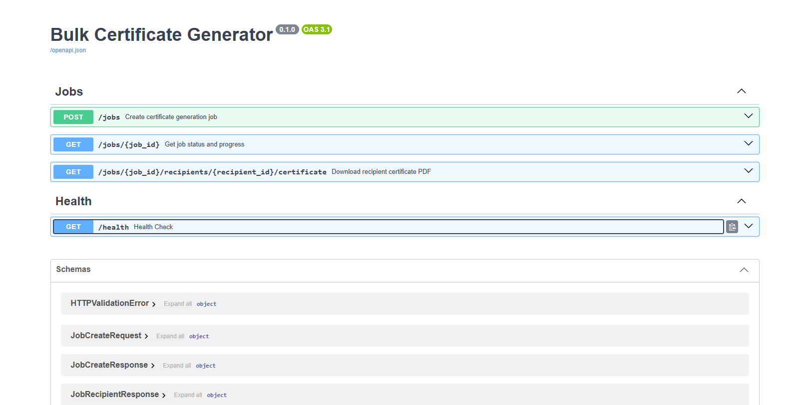
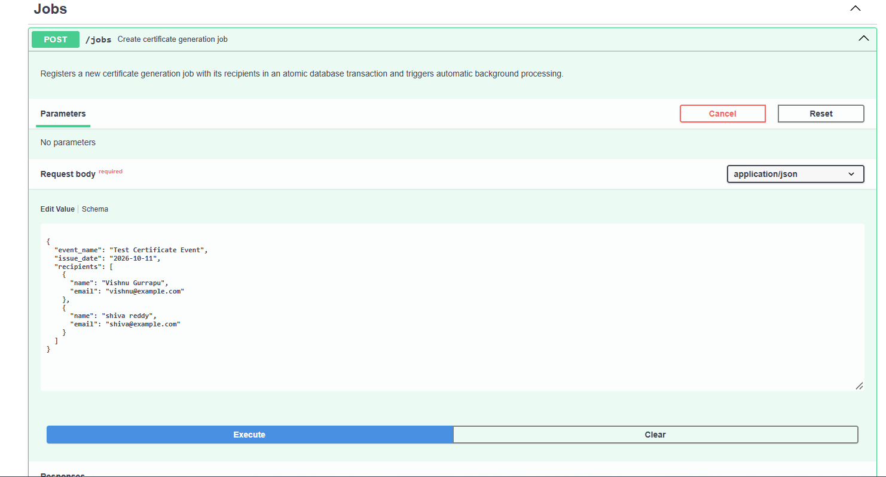
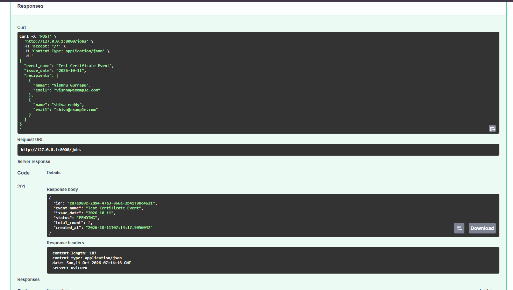
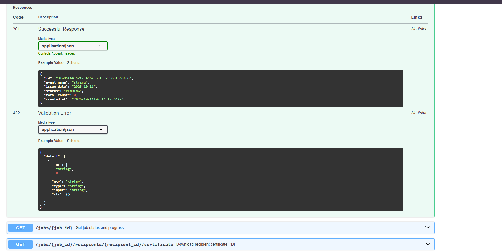
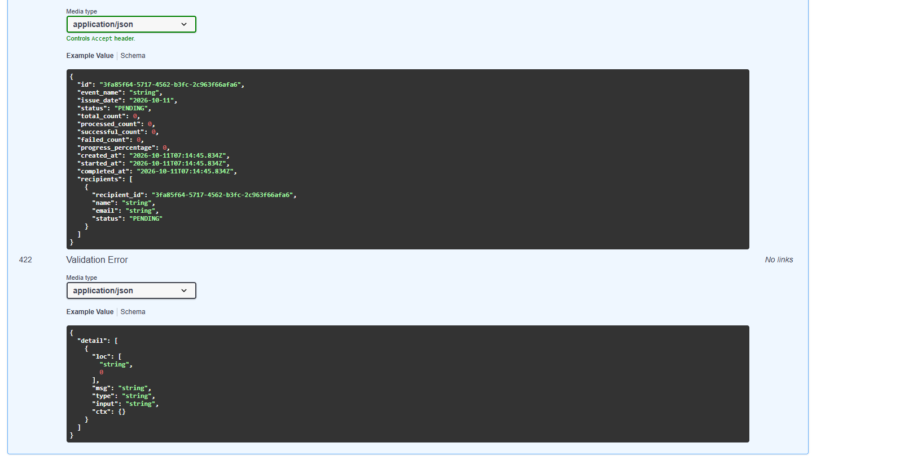
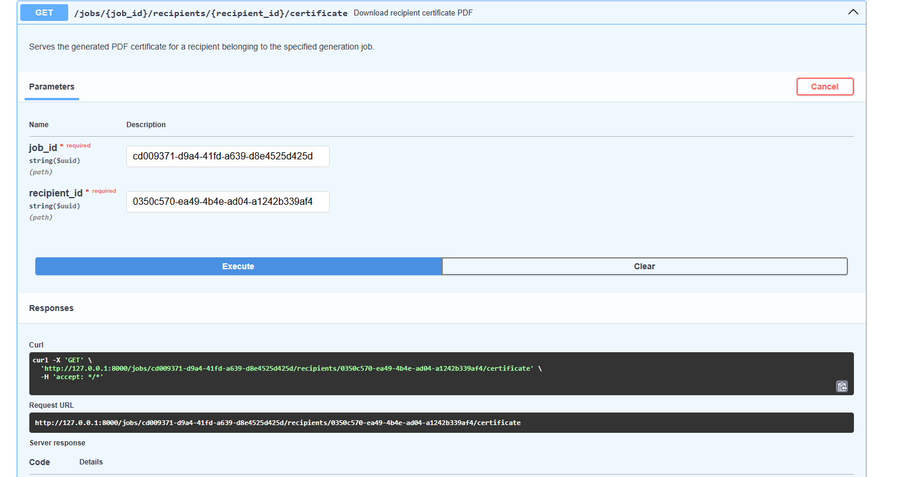
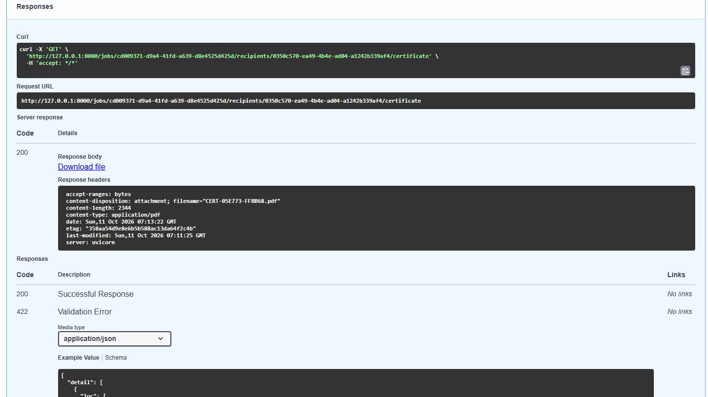
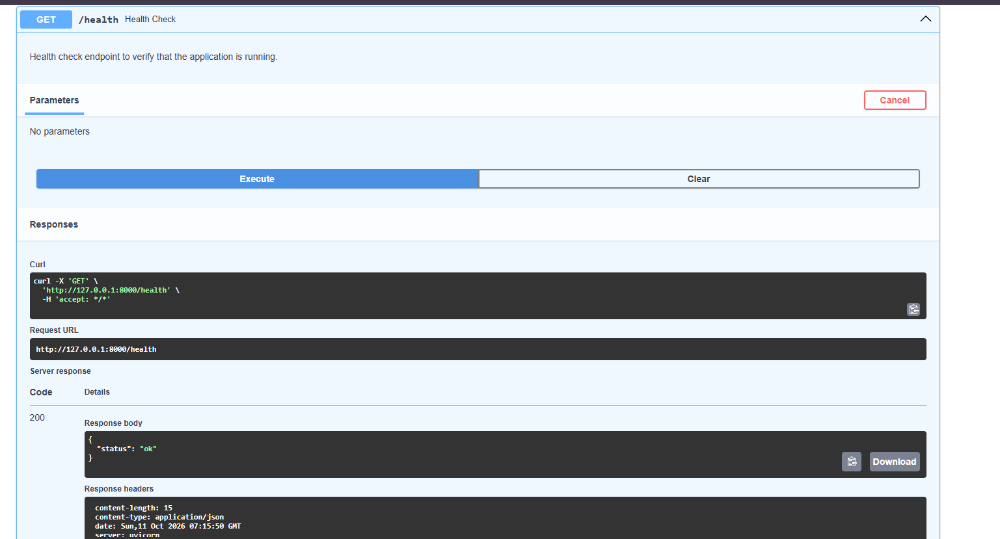

# Bulk Certificate Generator

## Project Purpose
Bulk Certificate Generator is a backend service designed to handle large-scale, automated certificate issuance for events, courses, and hackathons. Instead of manually rendering individual certificates, clients submit a batch of participant data to generate personalized vector PDF certificates, track job execution progress, and retrieve output files reliably.

---

## Project Status
Implemented and tested. Includes bulk certificate generation, job progress tracking, and PDF retrieval.

* **Implemented Components**:
  * Clean, modular project structure with separated concern boundaries.
  * Application configuration using Pydantic Settings with environment variable support (`storage_dir`, `database_url`).
  * FastAPI application entrypoint with interactive API documentation at `/docs`.
  * Operational health check endpoint at `GET /health`.
  * SQLAlchemy 2.0 database engine, declarative Base, and session factories with SQLite WAL mode, foreign-key enforcement, automatic schema backward compatibility for SQLite, and `UTCDateTime` normalization.
  * Database domain models: `GenerationJob` (with counter check constraints, issue date persistence) and `RecipientCertificate`.
  * Standalone PDF Generation Engine (`CertificateGeneratorService` in `app/services/certificate_generator.py`):
    * ReportLab pure-Python vector PDF rendering on landscape Letter layout.
    * Single predefined, professional certificate template with double borders, decorative accents, and signature lines.
    * Dynamic text fitting that scales down font sizes for long recipient or event names without overflowing.
    * Server-side unique certificate code generation (`CERT-XXXXXX-XXXXXX`).
    * UUID-based safe filenames and path-traversal prevention.
    * Injected storage directory support for test isolation.
    * Atomic file creation via temporary files (`.pdf.tmp`) with automatic error cleanup.
  * Reliable Job Processing Service (`JobProcessorService` in `app/services/job_processor.py`):
    * Atomic job claiming using conditional database updates to prevent concurrent duplicate processing.
    * Recipient batch validation (strict 500-recipient limit and count consistency).
    * Independent recipient processing with isolated error handling (single failures do not abort remaining recipients).
    * Counter reconciliation and strict invariant validation before terminal status finalization.
    * Safe orphan-file cleanup if database commits fail.
  * REST API Layer (`app/api/jobs.py`):
    * `POST /jobs`: Validates input, atomically persists job and recipient records, and immediately schedules in-process background processing.
    * `GET /jobs/{job_id}`: Tracks live progress, counter metrics, completion percentage, and recipient summaries (`recipient_id`, `name`, `email`, `status`).
    * `GET /jobs/{job_id}/recipients/{recipient_id}/certificate`: Securely streams generated certificate PDFs with strict storage containment checks and sanitized public error messages.
  * Automatic In-Process Background Processing via FastAPI `BackgroundTasks`.
  * Comprehensive automated test suite (77 passed, 1 warning) verifying PDF validity, metadata extraction, uniqueness, security boundaries, database invariants, reliable processing, error sanitization, and API workflows.

---

## PDF Generation Engine Architecture

The certificate generator is completely decoupled from HTTP routing and database transactions. It can be invoked directly as a pure domain service.

### 1. Template Specifications
* **Page Dimensions**: Standard landscape Letter (792 x 612 pt).
* **Color Palette**: Deep Navy (`#1A365D`), Warm Gold (`#C5A059`), Charcoal (`#2D3748`), Slate Grey (`#718096`).
* **Visual Elements**:
  * Outer primary border (4pt) and inner gold border (1.5pt) with corner geometric accents.
  * Header: "CERTIFICATE OF ACHIEVEMENT" with decorative separator line.
  * Recipient Name: Scaled dynamically to fit within a 620pt boundary; underlined with a gold accent.
  * Body: "has successfully participated in and completed" followed by the event name.
  * Footer: Left issuance date with signature line; right unique certificate identifier with verification line.

### 2. Security & Storage Guarantees
* **Server-Generated Codes**: Certificate identifiers are generated using cryptographically strong tokens (`secrets.token_hex`).
* **Path Traversal Protection**: Filenames are strictly validated against directory separators (`/`, `\`, `..`). All target paths must resolve strictly within the configured storage directory (`is_relative_to(storage_dir)`).
* **Atomic File Writing**: PDFs are initially rendered to a `.pdf.tmp` file and atomically renamed upon successful completion. Any rendering or disk failure immediately deletes partial files and raises `CertificateGenerationError`.

---

## Database Architecture & Models

### 1. `generation_jobs` Table
Stores bulk certificate generation requests and progress telemetry.

| Column | Type | Description |
| :--- | :--- | :--- |
| `id` | `UUID` (PK) | Globally unique identifier for the bulk job. |
| `event_name` | `VARCHAR(255)` | Name of the event or course for which certificates are issued. |
| `issue_date` | `DATE` | Nullable requested certificate issuance date printed on all certificates. |
| `status` | `ENUM` | Current lifecycle state: `PENDING`, `PROCESSING`, `COMPLETED`, `PARTIALLY_COMPLETED`, `FAILED`. |
| `total_count` | `INTEGER` | Total number of recipient certificates requested in the batch. |
| `processed_count` | `INTEGER` | Total recipients processed so far (`successful_count + failed_count`). |
| `successful_count` | `INTEGER` | Number of certificates rendered and saved successfully. |
| `failed_count` | `INTEGER` | Number of certificates that encountered errors during rendering. |
| `created_at` | `DATETIME (UTC)` | Timestamp when the job was accepted and persisted. |
| `started_at` | `DATETIME (UTC)` | Nullable timestamp when the background worker began processing. |
| `completed_at` | `DATETIME (UTC)` | Nullable timestamp when the batch finished processing. |

### 2. `recipient_certificates` Table
Stores individual participant records and their certificate generation outcomes.

| Column | Type | Description |
| :--- | :--- | :--- |
| `id` | `UUID` (PK) | Unique identifier for the recipient record. |
| `job_id` | `UUID` (FK) | References `generation_jobs.id` (`ON DELETE CASCADE`). |
| `recipient_name` | `VARCHAR(255)` | Full name printed on the certificate. |
| `recipient_email` | `VARCHAR(255)` | Email address of the participant (indexed). |
| `status` | `ENUM` | Individual state: `PENDING`, `PROCESSING`, `COMPLETED`, `FAILED`. |
| `certificate_code` | `VARCHAR(100)` | Unique identifier string for verification (indexed, unique, nullable). |
| `pdf_path` | `VARCHAR(500)` | Nullable relative file path to the generated PDF in local storage. |
| `error_message` | `VARCHAR(1000)`| Nullable error explanation if generation failed for this recipient. |
| `created_at` | `DATETIME (UTC)` | Timestamp when the record was created. |
| `processed_at` | `DATETIME (UTC)` | Nullable timestamp when processing completed or failed. |

---

## Background Processing Architecture & Operational Constraints

When a client calls `POST /jobs`, the application creates the job, persists its recipients, commits the database transaction, and automatically schedules the job processor in the background.

### 1. In-Process Execution via FastAPI `BackgroundTasks`
* **Triggering**: Automatic processing is scheduled using FastAPI's standard in-process `BackgroundTasks` after the creation transaction commits.
* **Non-Blocking**: The HTTP request returns immediately with `201 Created` and initial `PENDING` status, keeping the API responsive for clients.
* **Concurrency Protection**: The background processor reuses the service's atomic claim mechanism (`UPDATE generation_jobs SET status = 'PROCESSING' WHERE id = :id AND status = 'PENDING'`). Duplicate triggers or concurrent workers cannot claim or process the same job twice.
* **Fault Isolation**: Each recipient in the batch is processed independently. A rendering or data failure for one recipient does not stop processing for subsequent recipients.

### 2. Operational Limitations & Non-Durable Queue Notice
> [!WARNING]
> **In-Process Background Task Lifecycle & Volatility**:
> Automatic processing executes in-process within the running application process. If the application server process crashes, terminates, or restarts while background tasks are queued or running, in-progress jobs may be interrupted or lost.
>
> This architecture does **not** use a durable distributed queue (such as Celery, Redis Streams, or RabbitMQ). For production workloads requiring high availability and persistent crash recovery across restarts, an external durable message broker and dedicated worker fleet should be deployed.

---

## Prerequisites
* **Operating System**: Windows (or compatible Unix/macOS environment)
* **Python**: Python 3.12+ (tested with Python 3.12.3)
* **Shell**: PowerShell (Windows)

---

## Setup Instructions (Windows PowerShell)

### 1. Clone the Repository
```powershell
git clone https://github.com/VishnuGurrapu/bulk-certificate-generator.git
cd bulk-certificate-generator
```

### 2. Create a Virtual Environment
```powershell
python -m venv .venv
```

### 3. Activate the Virtual Environment
```powershell
.\.venv\Scripts\Activate.ps1
```
*(If script execution is disabled on PowerShell, run `Set-ExecutionPolicy -ExecutionPolicy RemoteSigned -Scope CurrentUser` first.)*

### 4. Install Dependencies
```powershell
python -m pip install --upgrade pip
pip install -r requirements.txt
```

### 5. Configure Environment Variables (Optional)
```powershell
Copy-Item .env.example .env
```

---

## Running the Application

Start the development server using Uvicorn:
```powershell
uvicorn app.main:app --reload
```

---

## Verifying the Application

### Test the Health Endpoint
```powershell
Invoke-RestMethod -Uri http://127.0.0.1:8000/health
```

### API Usage Examples (PowerShell)

#### 1. Create a Generation Job (`POST /jobs`)
Submit a certificate generation batch. The job is created and automatically begins processing in the background:

```powershell
$body = @{
    event_name = "Test Certificate Event"
    issue_date = "2026-10-11"
    recipients = @(
        @{ name = "Vishnu Gurrapu"; email = "vishnu@example.com" },
        @{ name = "Shiva Reddy"; email = "shiva@example.com" }
    )
} | ConvertTo-Json -Depth 5

$job = Invoke-RestMethod -Uri "http://127.0.0.1:8000/jobs" -Method Post -ContentType "application/json" -Body $body
$job
```

Example response (`201 Created`):
```json
{
  "id": "cd7e989c-2d94-47a3-866a-2b41f8bc4621",
  "event_name": "Test Certificate Event",
  "issue_date": "2026-10-11",
  "status": "PENDING",
  "total_count": 2,
  "processed_count": 0,
  "successful_count": 0,
  "failed_count": 0,
  "created_at": "2026-10-11T07:14:17.505604Z",
  "started_at": null,
  "completed_at": null
}
```

#### 2. Check Job Processing Status (`GET /jobs/{job_id}`)
Check batch execution status, progress percentage, counters, and per-recipient outcomes:

```powershell
$status = Invoke-RestMethod -Uri "http://127.0.0.1:8000/jobs/$($job.id)" -Method Get
$status
$status.recipients
```

Example response (`200 OK`):
```json
{
  "id": "cd7e989c-2d94-47a3-866a-2b41f8bc4621",
  "event_name": "Test Certificate Event",
  "issue_date": "2026-10-11",
  "status": "COMPLETED",
  "total_count": 2,
  "processed_count": 2,
  "successful_count": 2,
  "failed_count": 0,
  "created_at": "2026-10-11T07:14:17.505604Z",
  "started_at": "2026-10-11T07:14:17.600000Z",
  "completed_at": "2026-10-11T07:14:18.100000Z",
  "progress_percentage": 100.0,
  "recipients": [
    {
      "recipient_id": "8f3b2049-d71c-4b5f-9204-629df2495bb3",
      "name": "Vishnu Gurrapu",
      "email": "vishnu@example.com",
      "status": "COMPLETED"
    },
    {
      "recipient_id": "0350c570-ea49-4b4e-ad04-a1242b339af4",
      "name": "Shiva Reddy",
      "email": "shiva@example.com",
      "status": "COMPLETED"
    }
  ]
}
```

#### 3. Download a Generated Certificate (`GET /jobs/{job_id}/recipients/{recipient_id}/certificate`)
Extract the recipient ID from the job-status response and download the rendered vector PDF file for that recipient:

```powershell
# Extract recipient ID from the job status response (e.g. first recipient)
$recipientId = $status.recipients[0].recipient_id

# Download and save the certificate PDF
Invoke-WebRequest -Uri "http://127.0.0.1:8000/jobs/$($job.id)/recipients/$recipientId/certificate" -OutFile "vishnu_certificate.pdf"
```

### Access Interactive Documentation (Swagger UI)
Navigate to:
```
http://127.0.0.1:8000/docs
```

---

## Screenshots and Demo

The following visual walkthrough demonstrates the service running locally in Swagger UI (`http://127.0.0.1:8000/docs`), showcasing the end-to-end workflow from API exploration to certificate issuance and download.

### 1. Swagger API Overview
Interactive OpenAPI documentation listing available job management and health endpoints:


### 2. Creating a Certificate Generation Job
Submitting a certificate generation batch with event name, issue date, and recipients:


### 3. The 201 Created Response
Immediate HTTP 201 response returning initial PENDING status and job metadata while background processing begins:


Job creation response and validation schemas:


### 4. Job-Status Response Schema with Recipient IDs
Job status schema showing counter telemetry and recipient summaries with recipient IDs (`recipient_id`, `name`, `email`, `status`):


### 5. Certificate Download Request
Invoking the download endpoint with `job_id` and `recipient_id`:


### 6. Successful 200 OK PDF Download
HTTP 200 response streaming the rendered vector PDF certificate as an attachment:


### 7. Health Check Returning 200 OK
Operational verification endpoint returning HTTP 200 OK with service status:


### 8. Sample Generated Certificates
Sample vector PDF certificates rendered during local verification:
* [Sample Certificate — Vishnu Gurrapu (PDF)](docs/screenshots/Certificate1.pdf)
* [Sample Certificate — Shiva Reddy (PDF)](docs/screenshots/Certificate2.pdf)

---

## Running the Automated Tests

Run the full automated test suite:
```powershell
pytest -v
```

Run only the certificate generator engine tests:
```powershell
pytest tests/test_certificate_generator.py -v
```

Run only the database persistence tests:
```powershell
pytest tests/test_database.py -v
```
